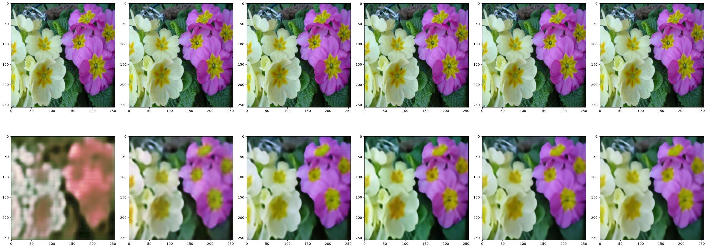

# Latent Space Diffusion Model

This is an unconditional latent space diffusion model made in PyTorch and trained on the Oxford Flowers 102 dataset. 

## VAE

A VAE was trained on the dataset, below is a sample of its performance across different epochs. 

The top row is the input image, and the bottom row is the reconstruction. Each column represents every 10th epoch (1,11,21,etc).
As can be seen, the VAE struggles to reconstruct the fine details of the image, for example, the center of the flowers. However, it is able to reconstruct the large-scale structure of the image quite well.